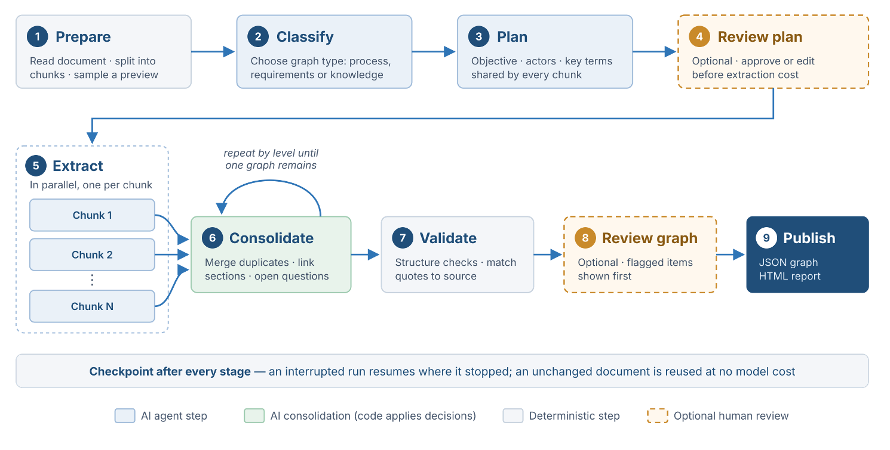
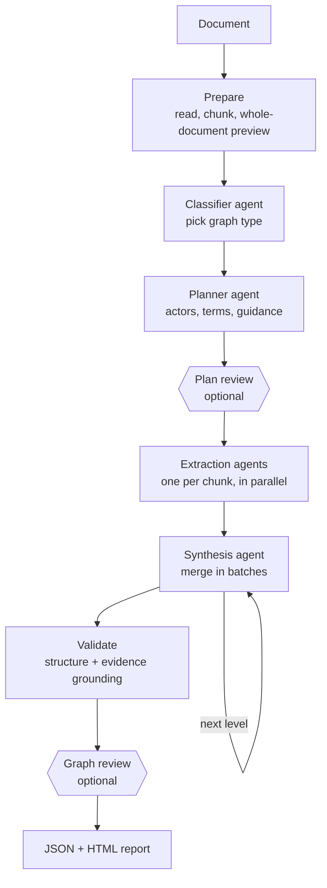

# Document Graph Extractor
Turns documents that are too large for a single LLM call (policies, SOPs,
requirement specs, reports) into an evidence-backed graph. A loan policy, for
example, becomes the loan-approval process: its steps, decisions, owners and
outcomes, each traced to a quote from the document.

The pipeline is multi-agent, built on **LangGraph** with **SQLite**
checkpoints. Runs resume after failures, can pause for human review, and are
scored by an evaluation loop.

## Features

- **Any document length.** The document is split into chunks, extracted in
  parallel and merged hierarchically.
- **Picks the graph type itself.** The classifier chooses between a business
  process, a requirements graph and a generic knowledge graph.
- **Traceable output.** Every step carries its source quote, and each quote is
  checked against the document.
- **Resumable.** Re-running the same command continues an unfinished run or
  reuses a finished one.
- **Optional human review** of the plan and of the final graph.
- **Evaluation loop.** It scores output against reference graphs and fails
  when quality regresses.
- **Business-readable report.** An HTML page with a process map, gaps to
  check, and a step-by-step table.

## How a Document Is Processed



## Quick start

Requires Python 3.10+ and an [OpenRouter](https://openrouter.ai/keys) or OpenAI API key.

```bash
python -m venv .venv && source .venv/bin/activate
pip install -r requirements.txt
cp .env.example .env          # add OPENROUTER_API_KEY (or OPENAI_API_KEY)

python main.py                                    # runs the sample loan policy
python main.py path/to/your_document.pdf          # PDF, DOCX, TXT or Markdown
```

Open `output/document_graph.html` to see the result. The same data is in
`output/document_graph.json`.

**Human review:**

```bash
python main.py policy.pdf --review       # pauses after the plan, then after the graph
python main.py policy.pdf --approve      # continue unchanged
python main.py policy.pdf --edited output/review/<run-id>/plan.json   # continue with your edits
```

**Evaluation:**

```bash
python evaluate.py                    # score every document in eval/dataset/
python evaluate.py --save-baseline    # accept the current scores as the baseline
```

### Configuration

| Setting | Default | Purpose |
|---|---|---|
| `OPENROUTER_API_KEY` / `OPENAI_API_KEY` | — | Which provider to use (OpenRouter wins if both are set) |
| `OPENROUTER_MODEL` / `OPENAI_MODEL` | `openai/gpt-4.1` / `gpt-4.1` | Model for all agents (or `--model`) |
| `--chunk-size`, `--chunk-overlap` | 12000, 800 | Characters per chunk / overlap between chunks |
| `--merge-batch-size` | 8 | Fragments combined per merge call |
| `--concurrency` | 4 | Parallel LLM calls; lower it if you hit rate limits |
| `--fresh` | off | Start a new run instead of resuming or reusing |

## Architecture



The agents call the LLM (OpenRouter or OpenAI) through one shared wrapper,
`BaseAgent`. LangGraph checkpoints every step to SQLite, and large data stays in
a work folder.

| Component | Responsibility |
|---|---|
| `core/workflow.py` | The LangGraph graph: nodes, parallel fan-out (`Send`), synthesis loop, review pauses (`interrupt`), retry policies |
| `core/runner.py` | Starts, resumes or continues a run with the SQLite checkpointer. Shared by `main.py` and `evaluate.py`. |
| `agents/` | Classifier, planner, extraction and synthesis agents. `base_agent.py` handles retries, JSON repair and parameter fallback. |
| `strategies/` | Prompts per graph type: `business_process`, `requirements`, `generic_knowledge` |
| `core/graph_utils.py` | Deterministic graph code: unique ids, applying merge decisions, structural validation |
| `core/evaluation.py` | Evidence grounding and scoring against reference graphs |
| `core/html_renderer.py` | The business-facing HTML report |

## Solution design

**1. Map-reduce over chunks.** No single call reads the whole document.
- The classifier and planner see a preview sampled across the entire document.
- Extraction runs on each chunk in parallel, guided by one shared plan, so
  every chunk uses the same vocabulary.

**2. Synthesis by decisions, not rewrites.** Fragments are merged in batches,
level by level. At each level the model sees a one-line-per-step listing and
returns only decisions:
- which steps are duplicates;
- which links across chunks are missing;
- corrections, such as marking the start step.

Code applies those decisions and keeps every step that isn't merged. Nothing
can be silently lost, and the model's replies stay small however large the
document is.

**3. Durable by design.** Every step is checkpointed to SQLite.
- Large data (chunks, fragments, intermediate graphs) lives in a work folder,
  so checkpoints hold only small values and paths.
- The run id is derived from the document and settings, which is what makes
  resume and reuse work.

**4. Reliability in layers.**
- LLM calls retry with backoff, repair invalid JSON, and drop parameters a model rejects.
- Each workflow step has a retry policy.
- A crash or Ctrl-C keeps all finished work.

**5. Quality you can see and measure.**
- Validation flags dead ends, missing start or end steps, decisions with a
  single branch, disconnected parts, and quotes not found in the document.
- Human review covers the cheapest point (the plan, before extraction) and the
  final graph, with flagged items listed first.
- `evaluate.py` scores node, edge and decision recall, condition and actor
  accuracy, and grounding against reference graphs. It exits non-zero on regression.

**Known limits.**
- Extraction quality depends on the model. Measure it with your own reference
  documents in `eval/dataset/`.
- The final merge lists every step once, which fits roughly 2,500–3,000 steps
  in a 200k-token context.
- Scanned PDFs need OCR first.

## Output

```text
output/
├── document_graph.html    business-readable report (open this)
├── document_graph.json    graph: steps, links, evidence, issues, open questions
├── checkpoints.sqlite     run state for resuming
├── review/<run-id>/       review files when using --review
└── work/<run-id>/         chunks, fragments, merge levels
```

## Project structure

```text
main.py              command line: run, resume, review
evaluate.py          evaluation loop
agents/              LLM agents
strategies/          prompts per graph type
core/                workflow, runner, graph logic, evaluation, rendering, I/O
eval/dataset/        documents + reference graphs (<name>.gold.json)
sample_documents/    sample inputs
tests/               offline tests (no API key needed): pytest
```
